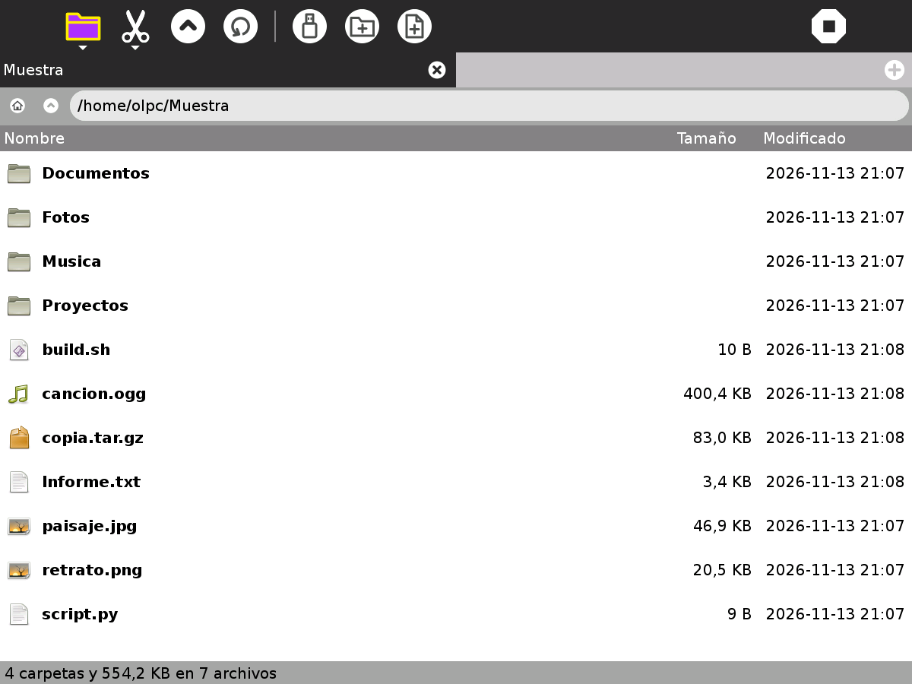

# Archivos

Explorador de archivos sencillo, con pestañas, para el entorno **Sugar** (OLPC).
Una especie de «Nautilus de bajo coste»: una sola lista de archivos por pestaña,
sin doble panel, sin miniaturas ni barras laterales, pensado para máquinas con
poca memoria.

Simple, tabbed file manager activity for **Sugar** (OLPC). A low-cost
"Nautilus": a single file list per tab, no dual pane, no thumbnails, no side
bars, built for machines with very little memory.

<p align="center">
  
</p>

## Qué hace

- Navega por carpetas; cada pestaña es una carpeta. Siempre hay al menos una
  (la carpeta personal) y se pueden abrir más con el botón **+**, que está a la
  derecha del todo de la barra de pestañas.
- **Reparto de las pestañas:** la primera ocupa la mitad del ancho; desde la
  segunda se reparten todo el ancho a partes iguales, cada vez más estrechas al
  añadir más. Cada una tiene su propia **X** para cerrarla.
- **Barra de estado:** «3 carpetas y 12,4 MB en 5 archivos» (con plurales y coma
  decimal según el idioma); con elementos seleccionados, cuántos y su peso.
- **Plugins** que abren archivos dentro de la actividad, en pestañas propias
  (ver [DOC/plugins.md](DOC/plugins.md)). Traen tres:
  - **Visor de imágenes**: un clic en una imagen la abre ajustada a la ventana
    (carga perezosa y reducida: una foto de 12 MP, en ~2 s); ← / → recorren las
    imágenes de la carpeta; botón de tamaño real.
  - **Reproductor multimedia** (GStreamer): Ogg/Theora y WebM/VP8 con audio Vorbis (y audio
    Ogg); reproducir/pausa, posición, volumen, y tres modos de ver: normal (ajustado
    a la ventana), 1:1 y pantalla completa (sin barras; Intro o espacio pausan, Esc sale). Es lo que decodifica el
    sistema de serie: para MP4 u otros formatos, convertir antes a Theora o WebM
    (p. ej. `ffmpeg -i in.mp4 -c:v libtheora -q:v 5 -c:a libvorbis -q:a 3 out.ogv`).
    **MP3:** el sistema no trae decodificador; con el paquete `gstreamer1-libav` (ver
    [DOC/plugins.md](DOC/plugins.md)) se reproduce con un clic.
    **Módulos de tracker** (`.mod`, `.xm`, `.it`, `.s3m`, `.stm`): con `gstreamer1-plugins-bad-free-extras`
    (elemento `modplug`) también se reproducen con un clic.
  - **Editor de texto** (GtkSourceView): números de línea, resaltado de sintaxis
    (Pascal, Python, C, shell...), deshacer, buscar y reemplazar, guardado atómico,
    conserva codificación (UTF-8/Latin-1) y finales de línea (LF/CRLF); avisa de
    los cambios sin guardar al cerrar la pestaña o la actividad. Si junto al
    archivo hay un `build.sh` y/o un `run.sh`, aparecen los botones **Compilar** y
    **Ejecutar** (también F7 y F5): guarda el archivo, ejecuta el script en esa
    carpeta y enseña la salida en un panel, con botón de **Parar**. Al cerrar la
    pestaña o la actividad, los programas que sigan en marcha se paran.
  *Abrir con* ofrece **todos** los plugins (primero los que reconocen el archivo),
  para forzar uno en un archivo que no identifica (un `.pas` renombrado a `.inc`).
  Cuantos más plugins, más entradas internas.
- **Otras actividades de Sugar como visores:** un PDF, DjVu o EPUB se abre en **Read**
  (u otra actividad que declare ese tipo en su `activity.info`) sin copiarlo al Diario.
  Con un clic si no hay plugin ni aplicación de escritorio para el tipo y solo una
  actividad lo reconoce; el resto de opciones, en *Abrir con*.
- **Ir a** (barra principal): menú con las unidades extraíbles montadas, un separador
  y las **carpetas favoritas**. Se marcan con la estrella del diálogo de propiedades
  y se guardan en `~/.config/archivos/` (de la aplicación, compartidas entre
  instancias; no van al Diario).
- **Propiedades** (clic secundario o Alt+Intro): tipo MIME, tamaño, fechas, y permisos y
  grupo editables (el propietario solo con root).
- **Comprimir y extraer** (`.tar`, `.tar.gz`, `.tgz`): clic secundario sobre uno
  o varios elementos → *Comprimir* → *Crear .tar* o *Crear .tar.gz*. Con un
  elemento el archivo lleva su nombre; con varios, el de la carpeta actual.
  Sobre un archivo comprimido aparece *Extraer*. Nunca sobrescribe, muestra
  progreso y se puede cancelar sin dejar restos. Al extraer rechaza rutas
  peligrosas (`..`, enlaces que salen de la carpeta, setuid) y detecta archivos
  truncados o dañados.
- Cerrar la última pestaña **cierra la actividad**.
- Filas altas, como las listas de las demás actividades de Sugar, con iconos de
  tipo de archivo del tema GNOME y el nombre en negrita.
- **Barra superior:** Subir, Actualizar, **Carpeta nueva** y **Archivo nuevo**
  (vacío, de 0 bytes; el nombre queda en edición). La barra **Editar** tiene
  Copiar, Cortar, Pegar, Renombrar y Borrar.
- **Clic principal:** entra en la carpeta o abre el archivo con la aplicación
  por defecto. Con **Ctrl** o **Mayús** solo selecciona.
- **Clic secundario:** menú con *Abrir*, *Abrir con*, *Abrir en una pestaña
  nueva*, *Copiar*, *Cortar*, *Pegar*, *Renombrar*, *Borrar*, *Carpeta nueva*,
  *Mostrar archivos ocultos* y *Actualizar*.
- Copiar, mover y borrar se hacen **en segundo plano**, con barra de progreso y
  botón de cancelar. Nunca sobrescribe: si el nombre existe, crea `nombre (2)`.
- Mover entre sistemas de ficheros distintos (por ejemplo, de la memoria
  interna a una tarjeta SD) copia y después borra el origen.
- Recuerda las pestañas abiertas en el Diario y las recupera al reanudar. Con el
  ajuste de Sugar `resume-activity` (activo por defecto), el icono de la vista de
  Inicio **reanuda la última entrada** en vez de crear otra; «Empezar nuevo», en
  la paleta del icono, sí crea una nueva.
- Textos en español e inglés según el idioma del sistema (se puede forzar con
  la variable `ARCHIVOS_LANG=es|en`). Las traducciones son ficheros `.po`
  estándar y se añaden otros idiomas sin tocar el código: ver
  [DOC/i18n.md](DOC/i18n.md).

## Atajos

| Tecla | Acción |
|---|---|
| Ctrl+T / Ctrl+W | Pestaña nueva / cerrar pestaña |
| Ctrl+RePág / Ctrl+AvPág | Pestaña anterior / siguiente |
| F2 | Renombrar |
| Supr | Borrar (pide confirmación) |
| Ctrl+C / Ctrl+X / Ctrl+V | Copiar / cortar / pegar |
| Retroceso o Alt+↑ | Subir una carpeta |
| Alt+Inicio | Ir a la carpeta personal (también, la casita de la barra de dirección) |
| Botón «Ir a» | Barra principal, antes de «Carpeta nueva»: unidades montadas y carpetas favoritas |
| F5 / F7 | En el editor: ejecutar `run.sh` / compilar con `build.sh` |
| Ctrl+L | Escribir una ruta |
| Alt+Intro | Propiedades |
| Ctrl+H | Mostrar u ocultar archivos ocultos |
| F5 | Actualizar |

## Instalación

Copia la carpeta del proyecto a `~/Activities/Archivos.activity` en el equipo
Sugar y reinicia la sesión de Sugar (o ábrela desde un terminal con
`sugar-activity ~/Activities/Archivos.activity archivos.ArchivosActivity`).

También se puede empaquetar un `.xo`: en Windows, `tools\package.ps1` (no necesita
Python ni git) y, en un Sugar con git, `python setup.py dist_xo`
(necesita `sugar-toolkit-gtk3`). El `.xo` queda en `dist/`.

Versión actual: 0.9. Cambios en [CHANGELOG.md](CHANGELOG.md); lo que viene en
[DOC/roadmap.md](DOC/roadmap.md).

## Requisitos

Sugar 0.112 (OLPC OS 13.2), Python 2.7, PyGObject 3.4 y GTK 3.6. Probado con
esas versiones.

## Pruebas y desarrollo

```
python -m unittest discover -s tests -v
```

Las pruebas de la lógica de archivos (`fileops.py`) no necesitan pantalla.
Para depurar la interfaz, véase [DOC/depuracion.md](DOC/depuracion.md); la
arquitectura está en [DOC/arquitectura.md](DOC/arquitectura.md).

## Licencia

MIT. Autor: XWolf.
